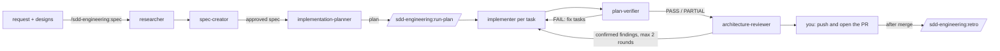

# sdd-engineering

Spec-driven development (SDD) for Claude Code: a feature goes from a request to reviewed code through four explicit
artifacts — a **spec** (what and why), a **plan** (how and in what order), the **code** (one task at a time) and a
**retro** (what to improve next time). Each step has its own agent with its own tools, so the model that decides
what to build is not the one that writes it, and the one that writes it is not the one that checks it.

```
/plugin marketplace add nazardrahusevych/agentic-engineering
/plugin install sdd-engineering@agentic-engineering
```

Installing it also installs its dependencies: `engineering-paved-path` (shared skills), `research-tools`
(`researcher`) and `architecture-review` (`architecture-reviewer`).

## What is inside

| Kind | Name | Role | Model |
|---|---|---|---|
| skill | `/sdd-engineering:spec` | runs the spec stage: research, then spec-creator | — |
| agent | `spec-creator` | interviews you and writes `specs/feat-<N>-<name>.md` with EARS acceptance criteria | opus |
| agent | `implementation-planner` | turns an approved spec into a Development Plan: contract, tasks, waves, traceability | opus |
| skill | `/sdd-engineering:run-plan` | runs the plan: implementer per task, plan-verifier, architecture review with fix rounds | — |
| agent | `implementer` | implements exactly one plan task, with its tests, and commits it | sonnet |
| agent | `plan-verifier` | traces every acceptance criterion to code and tests, ends with `VERDICT:` | sonnet |
| workflow | `/sdd-engineering:retro` | writes a retrospective of a finished feature with proposed harness changes | — |
| skill | `spec-format` | the spec template, EARS rules, lifecycle and file layout (preloaded by the agents) | — |

From the dependencies: `researcher` (facts from the code or the web, with sources) and `architecture-reviewer`
(layering and dependency direction of the branch), plus the shared skills the implementer loads per task.

## How it works together



| Step | You run | Agent / skill | Reads | Writes |
|---|---|---|---|---|
| 1. Spec | `/sdd-engineering:spec <request> [--designs <folder>]` | `spec` skill → `researcher` → `spec-creator` | the request, screenshots in `specs/designs/feat-<N>/`, the code | `specs/feat-<N>-<name>.md` (approved by you), `specs/research/feat-<N>-<name>.md` |
| 2. Plan | ask Claude to run `implementation-planner` with the spec path | `implementation-planner` | spec, research notes, code, `CLAUDE.md` / `AGENTS.md` | the plan as markdown → save to `specs/plans/feat-<N>-<name>.md` |
| 3. Implement | `/sdd-engineering:run-plan specs/plans/feat-<N>-<name>.md` (fresh session) | `run-plan` skill → `implementer` per task | plan, task skills, code | commits on `feat/<N>-<name>` |
| 4. Verify | (inside run-plan) | `plan-verifier` | spec, plan, the branch | a traceability report and `VERDICT: PASS \| PARTIAL \| FAIL` |
| 5. Review | (inside run-plan) | `architecture-reviewer` | the branch diff | candidate findings → fix tasks (at most 2 rounds) |
| 6. PR | you push and open the pull request | — | — | — |
| 7. Retro | `/sdd-engineering:retro feat-<N>-<name>` after the merge | `retro` workflow | spec, plan, commits, PR | `specs/retros/feat-<N>-<name>.md` |

Every step stops for you: you approve the spec, agree to the plan, and decide on the push and the PR. Agents never
push, merge or open pull requests.

### Spec lifecycle

`draft` → `approved` (only on your explicit word) → `in-progress` (run-plan starts) → `done` (verified and
reviewed). An approved spec is frozen; a gap found while planning reopens it to `draft` with your consent. Details:
the `spec-format` skill.

### Single-agent or multi-agent

The planner asks. **Single-agent** (default) runs the tasks one after another on the feature branch — cheap and
simple. **Multi-agent** runs independent tasks in parallel, each `implementer` in its own git worktree created from
the feature branch, and merges them wave by wave. Use it for many independent tasks across packages.

## What it expects from your repository

Defaults that your project's `CLAUDE.md` / `AGENTS.md` can override:

| Default | Used for |
|---|---|
| `specs/feat-<N>-<name>.md` | specs (Spec ID `SPEC-<N>`) |
| `specs/designs/feat-<N>/` | design screenshots (PNG/JPG) |
| `specs/research/feat-<N>-<name>.md` | research notes and the chosen approach |
| `specs/plans/feat-<N>-<name>.md` | plans |
| `specs/retros/feat-<N>-<name>.md` | retrospectives |
| `feat/<N>-<name>` | feature branches |
| the repository's default branch | base for feature branches and reviews |
| `CLAUDE.md` / `AGENTS.md` | install, typecheck and test commands; conventions; "do not touch" paths |
| `INSIGHTS.md` (optional) | confirmed, non-obvious lessons per module (`engineering-insights` skill) |

The agents work best when your instructions name the typecheck and test commands per package — the planner puts
them into every task's **Verify** line and the verifier runs them.

## Limits

- **No hard guards.** Claude Code ignores `hooks` in a plugin agent's frontmatter, so "writes only specs" and
  "read-only commands" are enforced by each agent's tool list and instructions, not by a hook. Review the diff after
  each writing agent.
- Cross-plugin skills are referenced as `engineering-paved-path:<skill>`.
- The agents follow your project's rules on commit messages and co-author lines.
- The retro is a proposal: apply the changes you agree with yourself.

## Versions

See [CHANGELOG.md](CHANGELOG.md). Releases are tagged `sdd-engineering--v<version>`.
