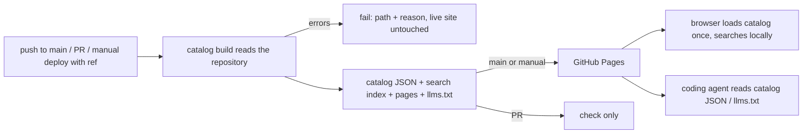

# Spec: Catalog site (MVP) | Spec ID: SPEC-1 | Status: in-progress
Supersedes: None
Designs: None

## Problem & why
The marketplace will hold many plugins, and each plugin bundles several skills, agents, commands, hooks and MCP
servers. Claude Code's `/plugin` screen lists plugins only, not what is inside them, so a user who needs "a skill
for X" has to read the repository to find it. A public catalog site with search over every artifact makes the
marketplace discoverable and lets a user go from a need to an install command in one step. It has to be built now,
before the plugin count grows, and it has to run on GitHub Pages: static hosting with no backend.

## Goals / Non-goals
**Goals:**
- Keyword search over every artifact in the marketplace, shown as cards, with filters and shareable URLs.
- One-click copy of the install command for the plugin that contains an artifact.
- A detail page per artifact with its full content and context.
- A machine-readable catalog and `llms.txt`, so coding agents can search the marketplace too.
- A way to request a missing artifact when a search finds nothing.
- The catalog is always generated from the repository itself; the site can be rolled back to any earlier ref.

**Non-goals:**
- Semantic / multilingual search (phase 2). A query in another language than the content may find nothing.
- Settings builder, trust panel (hooks, tools, network) and context-cost meter (phase 2).
- Workflow map, "what's new" feed, plugin dependency graph, eval badges, comments or ratings (phase 3).
- Accounts, install statistics, analytics or any tracking.
- Editing, submitting or installing plugins from the site (the site only shows the command).
- Any server, database or runtime call to the GitHub API: everything the site shows is produced at build time.
- Component types other than plugins, skills, agents, commands, hooks and MCP servers (output styles, LSP servers,
  themes, monitors, workflows) get no cards of their own; their plugin is still listed.
- Offline use and a no-JavaScript version beyond a message that JavaScript is required.
- A featured or curated section on the landing page; the landing shows the full list (AC-15).
- A custom domain.

## User stories
- As a developer, I want to type what I need in plain words and see matching skills, agents and other artifacts,
  so that I find a fitting tool without reading the repository.
- As a developer, I want to copy the install command from a result, so that I can install it in Claude Code at once.
- As a developer, I want to open an artifact and read what it does before installing, so that I know what I get.
- As a developer, I want to share a link to a search or an artifact, so that a teammate sees the same thing.
- As a coding agent, I want a machine-readable catalog, so that I can recommend an artifact without scraping HTML.
- As a user who found nothing, I want to request the missing artifact, so that the maintainer learns about the need.
- As the maintainer, I want the site to rebuild itself from the repository and to be able to roll it back, so that
  it never drifts from the plugins and a bad deploy is easy to undo.

## Acceptance criteria (EARS)

Catalog build
- **AC-1** — WHEN a commit lands on the default branch, the system SHALL build the catalog from the repository at
  that commit and deploy the site.
  *Verify:* manual — push to main, the deployed footer shows the new commit.
- **AC-2** — WHEN a pull request is opened or updated, the system SHALL run the catalog build as a check without
  deploying.
  *Verify:* manual — a PR shows the build check; the live site is unchanged.- **AC-3** — The catalog SHALL contain one entry per plugin listed in `.claude-plugin/marketplace.json`, and one entry
  per skill, agent, command and MCP server inside those plugins, plus one entry per plugin for its whole hook
  configuration (all events and matchers together).
  *Verify:* integration — a fixture marketplace produces exactly the expected entries.
- **AC-4** — Each catalog entry SHALL record its type, name, namespaced id (`<plugin>:<name>` for components),
  parent plugin, description, tags, category, the parent plugin's version, the path in the repository and the
  install command of its parent plugin.
  *Verify:* integration — fixture entries carry every field.
- **AC-5** — IF a plugin directory exists in the repository but is not listed in `marketplace.json`, THEN the
  catalog SHALL NOT include it or its components and the build SHALL report it as a warning.
  *Verify:* integration — an unlisted fixture plugin is absent and named in the build output.
- **AC-6** — IF a manifest, frontmatter or hook/MCP configuration cannot be parsed, or a skill or agent has no
  description, THEN the build SHALL fail with the file path and reason.
  *Verify:* integration — each broken fixture fails the build with its path.
- **AC-7** — IF the build fails, THEN the system SHALL keep the previously deployed site live.
  *Verify:* manual — a failing build on main leaves the live footer at the previous commit.
- **AC-8** — WHEN the maintainer starts a deploy and names a git ref (tag, branch or commit), the system SHALL build
  and deploy the site from that ref.
  *Verify:* manual — deploying an older tag shows that tag's commit in the footer.
- **AC-9** — The site SHALL show, in its footer, the commit and the date the deployed catalog was built from.
  *Verify:* e2e — footer text matches the build metadata.

Search and results
- **AC-10** — WHEN the user types in the search field, the system SHALL update the result cards as they type,
  without a network request per keystroke.
  *Verify:* e2e — results change while typing; no requests are made after the initial load.
- **AC-11** — The system SHALL match a query against the artifact name, description, tags, parent plugin name and
  body text.
  *Verify:* unit — a term found only in each field returns the artifact.
- **AC-12** — The system SHALL rank matches in the name, description or tags above matches found only in the body
  text.
  *Verify:* unit — of two fixtures matching the same term, the name match ranks first.
- **AC-13** — The system SHALL match word prefixes and words with a small typo (one edit for words of 5+ letters).
  *Verify:* unit — "secur" and "secuirty" both find a "security" skill.
- **AC-14** — WHEN a query contains several words, the system SHALL rank artifacts matching more of the words
  higher than artifacts matching fewer.
  *Verify:* unit — a fixture matching two of three words ranks above one matching a single word.
- **AC-32** — The system SHALL ignore common English filler words in a query ("I", "need", "a", "for", "want",
  "something", …), so that "I need a skill for reviewing pull requests" finds the review artifacts.
  *Verify:* unit — the example sentence returns the review fixtures first.
  (IDs are stable, not ordered: AC-32 was split out of AC-14.)
- **AC-15** — WHILE the query and filters are empty, the system SHALL show all artifacts, plugins first, then
  components grouped by type, each group sorted by name.
  *Verify:* e2e — the landing page lists every fixture in that order.
- **AC-16** — IF a query with the current filters matches nothing, THEN the system SHALL show an empty state with a
  "clear filters" action (when filters are set) and a "Request it" link.
  *Verify:* e2e — a nonsense query shows both.
- **AC-17** — WHEN the user follows "Request it", the system SHALL open a new GitHub issue form of this repository,
  pre-filled with the query and active filters and a "request" label.
  *Verify:* e2e — the link points to the new-issue URL with the encoded query.
- **AC-18** — WHEN the user presses `/` outside a text field, the system SHALL focus the search field.
  *Verify:* e2e.

Cards and install
- **AC-19** — Each result card SHALL show the type badge, name, parent plugin, the description cut to two lines,
  up to three tags and a "Copy install" button.
  *Verify:* e2e — a fixture card shows each element.
- **AC-20** — WHEN the user activates "Copy install", the system SHALL copy
  `/plugin install <plugin>@agentic-engineering` for the card's parent plugin and confirm the copy visibly for
  about two seconds.
  *Verify:* e2e — clipboard content and confirmation.
- **AC-21** — IF the clipboard is not available, THEN the system SHALL show the command in a selected text field
  for manual copying.
  *Verify:* e2e — with clipboard access denied.
- **AC-22** — The landing page SHALL show the command that adds the marketplace
  (`/plugin marketplace add nazardrahusevych/agentic-engineering`) with its own copy button.
  *Verify:* e2e.

Filters and URLs
- **AC-23** — The system SHALL offer filters by type, plugin, category and tag, each option showing how many
  artifacts in the current result set have it.
  *Verify:* e2e — counts change as the query changes.
- **AC-24** — WHEN several filters are set, the system SHALL combine options of one filter with OR and different
  filters with AND.
  *Verify:* unit.
- **AC-25** — WHEN the query or filters change, the system SHALL reflect them in the page URL, and WHEN a page is
  opened with such a URL, the system SHALL restore the same query and filters.
  *Verify:* e2e — reload keeps the state; a copied URL reproduces it in a new tab.

Detail page
- **AC-26** — WHEN the user opens a card, the system SHALL show the artifact's detail page at a stable URL based on
  its namespaced id.
  *Verify:* e2e — the URL survives a reload and a rebuild.
- **AC-27** — The detail page SHALL show the full description, the rendered body (the `SKILL.md`, agent or command
  text; the events and matchers of a hook configuration; the name and command of an MCP server), the files of the
  artifact's directory, the install command, a link to the source in the repository, and the other artifacts of
  the same plugin.
  *Verify:* e2e — one fixture of each type.
- **AC-28** — The plugin detail page SHALL additionally show the plugin version, license, author and its changelog.
  *Verify:* e2e.
- **AC-29** — IF a URL names an artifact that is not in the catalog, THEN the system SHALL show a "not found" page
  with a search field pre-filled with the name from the URL.
  *Verify:* e2e.

Machine-readable catalog
- **AC-30** — The system SHALL publish the catalog as one JSON document at a stable URL, with a schema version and
  the build commit, containing every entry with the fields of AC-4 and the URL of its detail page.
  *Verify:* integration — the published file validates against the documented shape.
- **AC-31** — The system SHALL publish `llms.txt` at the site root that describes the marketplace, links the JSON
  catalog and lists each plugin with its components and detail-page URLs.
  *Verify:* integration.

## Edge cases
- Marketplace with no plugins → AC-15 shows an empty landing with the AC-22 command; AC-16 for searches.
- Plugin directory not listed in `marketplace.json` → AC-5.
- Broken manifest or frontmatter, missing description → AC-6, live site untouched → AC-7.
- Two plugins contain a skill with the same name, or one skill shared through a symlink → separate entries, told
  apart by namespaced id → AC-4, AC-26.
- Query in Ukrainian or another language than the content → may find nothing → AC-16; better results are a
  Non-goal (phase 2).
- Query with HTML, quotes or regex characters → treated as plain text → Untrusted inputs, AC-10.
- Very long query (pasted paragraph) → only the first 200 characters are used → AC-14 still applies.
- URL with unknown filter values → unknown values are ignored, known ones restored → AC-25.
- Deep link to an artifact removed in a later build → AC-29.
- Clipboard blocked (non-HTTPS preview, browser policy) → AC-21.
- JavaScript disabled → a static message that JavaScript is required → Non-goal (beyond the message).
- Component types without cards (output styles, LSP, themes) → Non-goal; the plugin entry still lists them by name in
  its file list (AC-27).

## Flows & contracts

Catalog entry (meaning, not a schema): `id` (namespaced), `type` (plugin | skill | agent | command | hooks | mcp),
`name`, `plugin`, `pluginVersion`, `description`, `tags`, `category`, `path` (in the repository), `sourceUrl`,
`detailUrl`, `install` (command string). The document carries `schemaVersion`, `marketplace`, `commit`, `builtAt`.

## Non-functional
- Performance: with 500 artifacts, the first page is usable within 2 s on a mid-range phone over 4G; the data loaded
  for search is at most 400 KB compressed; a search updates the results within 50 ms after the last keystroke
  (not counting the input debounce).
- Build: the catalog build finishes within 2 minutes on CI.
- Accessibility: WCAG 2.1 AA — keyboard reachable cards and filters, visible focus, labelled controls, result count
  announced to screen readers; light and dark themes follow the system setting.
- Layout: usable from 360 px width without horizontal scrolling.
- Privacy: no cookies, analytics, trackers or third-party requests at runtime other than the site's own files.
- Language: the site UI is English.
- Hosting: `https://nazardrahusevych.github.io/agentic-engineering/`; every link and asset works under that path
  prefix.
- Cost: no LLM calls, no paid services; free GitHub Pages and Actions only.

## Inputs (provenance)
- Plugins list and their sources — [deterministic: `.claude-plugin/marketplace.json`]
- Plugin metadata (version, license, author, keywords) — [deterministic: each plugin's `plugin.json`]
- Skills, agents, commands — [deterministic: their markdown files and frontmatter]
- Hooks, MCP servers — [deterministic: each plugin's hook and MCP configuration files]
- Changelog — [deterministic: each plugin's `CHANGELOG.md`]
- Build commit and date — [deterministic: git]
- No LLM calls.

## Untrusted inputs
The artifact texts (markdown bodies, frontmatter, descriptions, changelogs) are rendered on a public page and, once
the marketplace accepts contributions, may be written by others. They are data, never markup to trust: rendered
markdown is sanitized (no scripts, inline event handlers, iframes or raw HTML that can execute), links are limited
to `http(s)` and repository-relative targets and open with `noopener`. The search query and URL parameters are
treated as plain text and are never inserted as HTML; the "Request it" link encodes them as URL parameters only.

## Proposed improvements
- [accepted] Machine-readable catalog + `llms.txt` (AC-30, AC-31) — near-zero cost, lets agents use the marketplace.
- [accepted] "Request it" via a pre-filled GitHub issue (AC-17) — collects demand without a backend.
- [accepted] Build check on pull requests (AC-2) — catches broken frontmatter before it reaches main.
- [accepted] Deploy from a named ref (AC-8) — the site's rollback path, see `docs/releasing.md`.
- [deferred: phase 2] Semantic multilingual search — embeddings computed at build time, query embedded in the
  browser; no backend.
- [deferred: phase 2] Settings builder (`.claude/settings.json` with chosen plugins), trust panel, context-cost meter.
- [deferred: phase 3] Workflow map, "what's new" feed with RSS, dependency graph, eval badges, Giscus comments.

## [NEEDS CLARIFICATION]
None. Resolved 2026-11-23: the repository is public, so the site deploys from the first build (AC-1); site at
`nazardrahusevych.github.io/agentic-engineering`, no custom domain (Non-functional, Non-goals); one hooks entry per
plugin (AC-3); no featured section (Non-goals).

## Self-check
- [x] Every AC is atomic (one checkable thing) and testable (trigger, state and response are visible).
- [x] No AC contradicts another.
- [x] Behaviour and boundaries, not implementation.
- [x] Non-goals are explicit.
- [x] Every edge case maps to an AC or a Non-goal.
- [x] No inline `[NEEDS CLARIFICATION: …]` marker remains and that section says None (required for `approved`).
