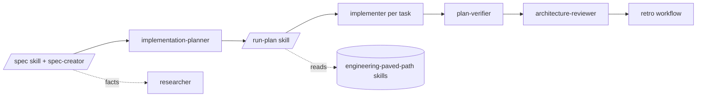

# Spec: SDD plugins (first marketplace content) | Spec ID: SPEC-2 | Status: done
Supersedes: None
Designs: None

## Problem & why
The marketplace is live but empty. RevAI already has a working spec-driven development (SDD) harness — agents,
skills and a run-plan process in `C:\Repos\Revai\.claude` — but it is written for RevAI: it names RevAI's packages,
paths (`server/`, `client/`, `vendor/shared`), commands and conventions. To share it, the harness has to become a
set of public, project-neutral plugins: one workflow plugin for SDD, a few small plugins other plugins can reuse,
and a README for each that explains how to use it.

## Goals / Non-goals
**Goals:**
- Four plugins in `plugins/`, listed in `.claude-plugin/marketplace.json`, each with `plugin.json`, `README.md` and
  `CHANGELOG.md`, starting at version `0.1.0`:

  | Plugin | Role | Contents | Depends on |
  |---|---|---|---|
  | `engineering-paved-path` | reusable base | skills: `onion-architecture`, `frontend-architecture`, `security`, `typescript-expert`, `zod`, `react-best-practices`, `react-testing-library`, `next-best-practices`, `fastify-best-practices`, `drizzle-orm-patterns`, `postgresql-table-design`, `mermaid-diagram`, `engineering-insights` | — |
  | `research-tools` | reusable | agent `researcher` | — |
  | `architecture-review` | reusable | agent `architecture-reviewer` | `engineering-paved-path` |
  | `sdd-engineering` | the SDD workflow | agents `spec-creator`, `implementation-planner`, `implementer`, `plan-verifier`; skills `spec`, `run-plan`, `spec-format`; workflow `retro` | `engineering-paved-path`, `research-tools`, `architecture-review` |

- `sdd-engineering/README.md` explains the whole cycle: spec → plan → run-plan → verify → review → retro, which
  plugin supplies each step, and the files each step reads and writes.
- No artifact names RevAI, DevDigest, a RevAI path or a RevAI command.

**Non-goals:**
- RevAI-only artifacts: `pr-self-review` (its gate and routing are RevAI's), `dependency-checker` (RevAI's package
  list), `doc-writer`, `investigator`, `brainstorm`, `insight-curator`, `test-writer-*`. Candidates for later specs.
- Agent guard hooks (`specs-only.mjs`, `bash-allowlist.mjs`, …): Claude Code ignores `hooks` in a plugin agent's
  frontmatter, and plugin-level hooks would apply to every session, not only to that agent. Read-only agents stay
  read-only through their `tools` list.
- Removing the artifacts from RevAI or making RevAI install these plugins (a later step).
- Site changes for the new content (SPEC-3).

## User stories
- As a developer on any project, I want to install `sdd-engineering` and get the spec → plan → implement → verify
  cycle, so that I do not have to build the harness myself.
- As a plugin author, I want shared engineering skills in one plugin, so that my agents can rely on them without
  copying them.
- As a user, I want each plugin's README to tell me what it contains, how to start and what it expects from my
  repository.

## Acceptance criteria (EARS)

Structure
- **AC-1** — The marketplace SHALL list exactly the four plugins of the Goals table, each with a `./plugins/<name>`
  source, a description, a category and tags.
  *Verify:* integration — the catalog build of the repository lists the four plugins and their components.
- **AC-2** — Each plugin SHALL contain `.claude-plugin/plugin.json` (name, version `0.1.0`, description, author,
  license, keywords), `README.md` and `CHANGELOG.md` in the format `scripts/release.mjs` maintains.
  *Verify:* unit — a repository check reads every plugin.
- **AC-3** — Each plugin SHALL contain exactly the agents, skills and workflow named in the Goals table.
  *Verify:* integration — catalog entries per plugin equal the expected list.
- **AC-4** — `architecture-review` SHALL declare `engineering-paved-path` in `dependencies`, and `sdd-engineering`
  SHALL declare `engineering-paved-path`, `research-tools` and `architecture-review`.
  *Verify:* unit — the repository check reads `plugin.json` `dependencies`.
- **AC-5** — Every dependency SHALL name a plugin of this marketplace, and the dependency graph SHALL have no cycle.
  *Verify:* unit.

Project neutrality
- **AC-6** — No file under `plugins/` SHALL contain "RevAI", "revai", "DevDigest" or "devdigest", RevAI package
  paths (`server/src`, `client/src`, `reviewer-core`, `vendor/shared`, `server/clones`), or absolute local paths.
  *Verify:* unit — the repository check scans every file and reports file and line.
- **AC-7** — WHERE an artifact needs a project location (specs, plans, notes, verify commands), it SHALL use a
  documented default (`specs/`, `specs/plans/`, the project's `CLAUDE.md` / `AGENTS.md` for commands) that the
  project's own instructions can override, and the plugin README SHALL list these defaults.
  *Verify:* manual — README review.
- **AC-8** — Every agent and skill that references another skill SHALL reference only skills in its own plugin or
  in a plugin it declares as a dependency.
  *Verify:* unit — the repository check resolves `skills:` lists and skill mentions.

Agents and skills
- **AC-9** — `implementer` SHALL be one agent for any task zone (it replaces RevAI's `implementer-backend` and
  `implementer-ui`): it preloads only `security` and `typescript-expert` and loads the skills its task names.
  *Verify:* manual — agent review.
- **AC-10** — Plugin agents SHALL use only frontmatter fields Claude Code supports for plugin agents (no `hooks`,
  `permissionMode`, `mcpServers`, `initialPrompt`).
  *Verify:* unit — the repository check parses every agent's frontmatter.
- **AC-11** — `run-plan` SHALL run the plan's tasks single-agent by default and use only agents from
  `sdd-engineering` and its dependencies (no RevAI-only agents such as `doc-writer` or `pr-self-review`).
  *Verify:* manual — skill review.
- **AC-12** — The `retro` workflow (`workflows/retro.js`) SHALL read a finished feature's spec, plan, research
  notes, commits, pull request and recorded verifier verdict, and write a retrospective to `specs/retros/feat-<N>-<name>.md` with: what went as planned,
  deviations, failed attempts, and proposed changes to the plugins' agents or skills.
  *Verify:* manual — run it on SPEC-1 of this repository.

Documentation
- **AC-13** — Each plugin README SHALL describe what it contains, install commands (`/plugin install
  <name>@agentic-engineering`), its dependencies, how to start, what it expects from the repository, and its limits.
  *Verify:* manual.
- **AC-14** — `sdd-engineering/README.md` SHALL include a diagram of the cycle and a table step → agent / skill →
  input → output.
  *Verify:* manual.

Checks
- **AC-15** — The repository check (AC-2, AC-4–AC-6, AC-8, AC-10) SHALL run in its own GitHub Actions workflow
  (`Validate`), separate from the site workflow, on every pull request and push to `main`.
  *Verify:* manual — a PR shows "Validate" and "Site" as separate checks.

## Edge cases
- A skill is used by two plugins → it lives in `engineering-paved-path` only; others depend on it → AC-8.
- A RevAI skill mixes generic advice with RevAI specifics → keep the generic rules, drop or generalise the rest;
  stack-specific skills (Fastify, Drizzle, Next.js) keep the library advice → AC-6.
- A user installs `sdd-engineering` alone → Claude Code installs its dependencies → AC-4.
- A project without `specs/` → agents create it on first use → AC-7.

## Flows & contracts

## Non-functional
- Content in English; no network calls in hooks or scripts; no runtime dependencies in plugins.
- Each `SKILL.md` stays under ~500 lines (detail goes to `reference.md`).

## Inputs (provenance)
- Agents and skills — [deterministic: `C:\Repos\Revai\.claude\agents`, `.claude\skills`], adapted.
- Plugin format — [deterministic: `docs/research/marketplace-setup.md`, Claude Code plugin reference].
- No LLM calls at build time.

## Untrusted inputs
Plugin content is installed into other people's sessions: no instructions that send data elsewhere, no hooks.

## [NEEDS CLARIFICATION]
- Retro content: RevAI has no retro yet; AC-12 is a proposal — confirm the sections.
- Stack-specific skills (Fastify, Drizzle, PostgreSQL, Next.js, React Testing Library) in `engineering-paved-path`,
  or a separate stack plugin later?
